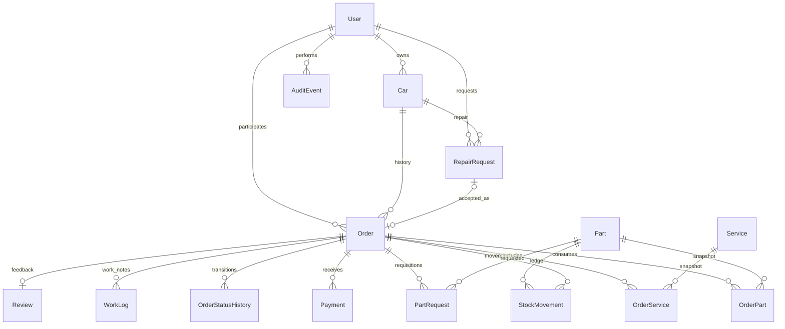

# Talablar tahlili va arxitektura

Ikki manba bir-birini to‘ldiradi: qisqa reja ustuvor biznes qoidalarini, roadmap esa endpoint va sahifalarni belgilaydi. Texnologiyalar: Django 5.2, DRF, Simple JWT, PostgreSQL; React, Router, Axios, Tailwind, Context.

## Ma’lumotlar sxemasi

## Qoidalar va ziddiyatlar bo‘yicha qarorlar

| Masala | Amalga oshirilgan qaror |
| --- | --- |
| COMPLETED dan bekor qilish | Qisqa reja va roadmap matniga muvofiq, to‘lov bo‘lmasa mumkin |
| CANCELLED va PAID | Yakuniy statuslar; qayta ochilmaydi |
| Bekor qilingandagi ehtiyot qismlar | Tranzaksiyada omborga qaytariladi, tarixiy buyurtma qatorlari saqlanadi |
| Qisman to‘lov | Mavjud; yig‘indi jami summaga tenglashganda PAID |
| To‘lov mavjud buyurtmani bekor qilish | Taqiqlangan; pul qaytarish moduli bu versiyada yo‘q |
| Manager katalog huquqi | Services/Parts CRUD va kirim; xodim yozish faqat admin |
| Mijoz avtomobil yozishi | O‘z avtomobilini yaratadi/tahrirlaydi; tarix mavjud bo‘lsa egasi almashmaydi |
| Bo‘sh hisob | Musbat jami summasiz yakunlash mumkin emas |
| SQLite | Faqat lokal demo/test; parallel ombor amallari uchun PostgreSQL kerak |

## Tuzilish

`core/models.py`: 15 ta domen modeli. `core/serializers.py`: validatsiya va API ko‘rinishlari. `core/services.py`: status, narx, sarf va to‘lov qoidalari. `core/views.py` va `core/role_views.py`: API, rol filtrlari, tranzaksiyalar va hisobotlar. `core/audit.py`: jarayonlar jurnali. `frontend/src/api.js`: JWT so‘rovlari va bir vaqtdagi refreshni birlashtirish. `frontend/src/main.jsx`: asosiy sahifalar va routing. `frontend/src/RoleFeatures.jsx`: rol dashboardlari, murojaatlar, qism so‘rovlari, ish qaydlari, fikrlar, profil va hisob-faktura. Yangilangan ruxsatlar: [roles.md](roles.md).

Mablag‘lar Decimal bilan saqlanadi. Order qatori barcha hisobni o‘zgartiruvchi amallarda qulflanadi; Part sarf/kirim/qaytarishda qulflanadi. Katalog narxi keyin o‘zgarsa, OrderService/OrderPart snapshot narxi o‘zgarmaydi. Order va tarixiy havolalar o‘chirishdan himoyalangan.

## Chegaralar

Bildirishnomalar va refund ixtiyoriy/keyingi bosqich modullari sifatida qoldirildi. Production hosting hisoblari berilmagan, tashqi deploy qilinmagan. Brauzer orqali vizual/E2E tekshiruv va PostgreSQLdagi parallel tranzaksiya sinovi ushbu muhitda bajarilmagan; API integratsiya testlari va frontend build mavjud.
